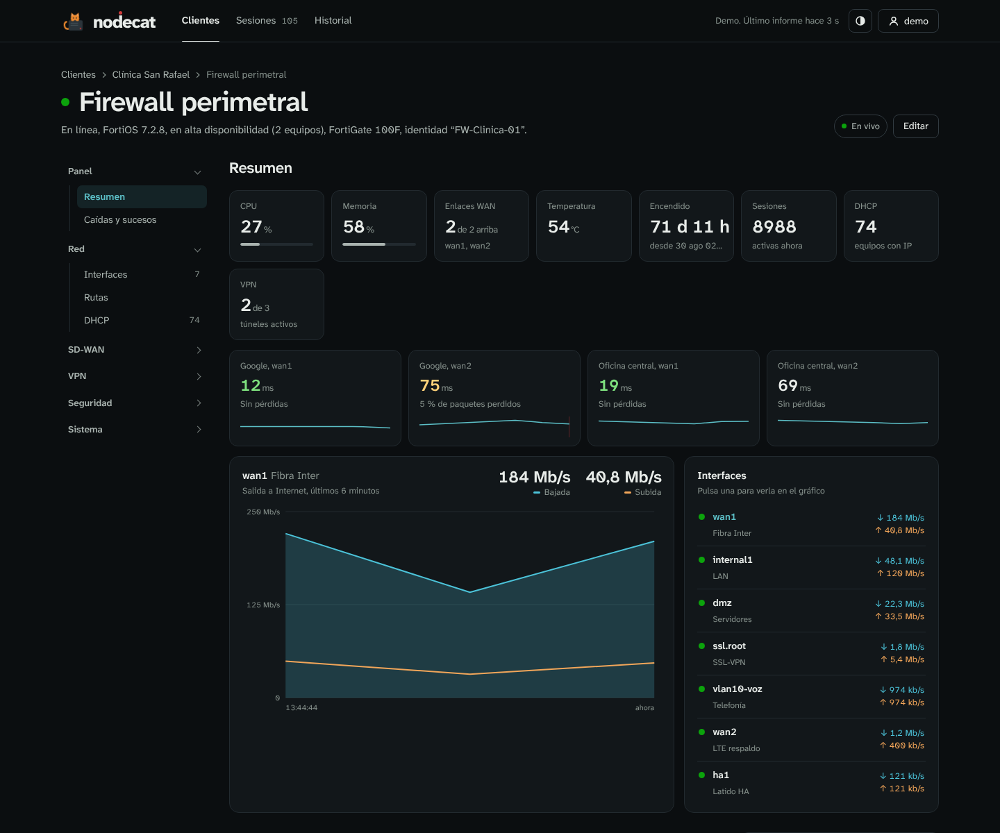
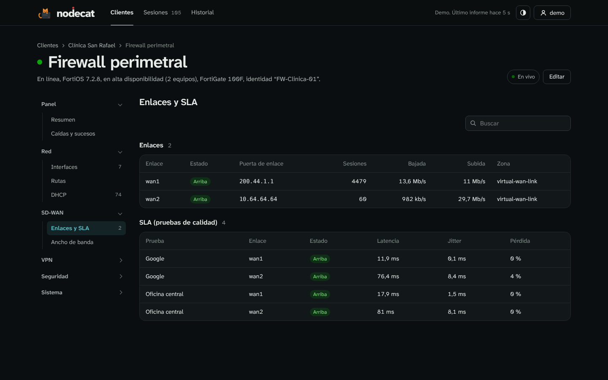
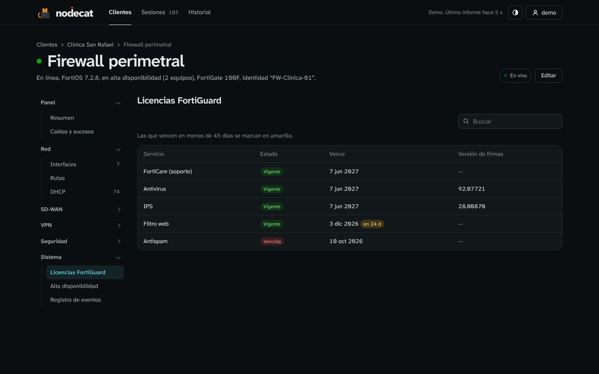

<p align="center">
  
</p>

<h1 align="center">NodeCat</h1>

<p align="center">
  Todos tus clientes, todos sus servidores, desde un mismo lugar.<br>
  Servidores Windows, routers MikroTik, firewalls FortiGate, sesiones de Escritorio remoto y avisos por Telegram.
</p>

<p align="center">
  
</p>

---

NodeCat es un panel web para quien da soporte a varias empresas. Cada cliente tiene su propio agente: lo instalas en sus servidores y aparecen solos dentro de su cliente, sin VPN y sin abrir puertos en su red. El agente solo necesita salida a Internet hacia NodeCat.

Es la evolución multicliente de [Vigía](https://github.com/foxyproxy14-dev/vigia), con el mismo diseño y el mismo agente.

## Qué hace

- **Resumen por cliente.** De un vistazo, qué clientes necesitan atención, cuántos servidores tienen en línea y cuál está peor de CPU, memoria o disco.
- **Página de cada cliente** con sus servidores, sus problemas y sus últimos sucesos (caídas, vueltas, reinicios).
- **Página de cada servidor** con gráficos de CPU y memoria de 1 hora a 30 días, discos, disponibilidad, caídas y sesiones.
- **Routers MikroTik al estilo MikroDash**, en solo lectura: tráfico en vivo de cada interfaz, enlace WAN, latencia a Cloudflare, Google y la puerta de enlace, CPU, memoria y temperatura, con un menú lateral como el de MikroDash: red (IP, rutas, ARP, DNS, bridges y VLAN, vecinos), inalámbrico (clientes por red, redes, CAPsMAN), servicios IP, túneles y VPN, tráfico (ancho de banda, colas, conexiones con los destinos más usados), seguridad (filtro, NAT, mangle, listas), sistema (registro, paquetes y firmware, servicios, scripts, tareas, NTP, SNMP, archivos, contenedores, usuarios), ping y traceroute desde el router, y el historial de caídas. Funciona con RouterOS 6 y 7.
- **FortiGate**, también en solo lectura y con su propio menú: CPU, memoria, sesiones, temperatura, tráfico en vivo, enlaces SD-WAN con latencia, jitter y pérdida de cada SLA, túneles IPsec y SSL-VPN, políticas con sus usos, rutas, DHCP, licencias FortiGuard (avisa de las que vencen pronto), alta disponibilidad, usuarios autenticados y registro de eventos. Funciona con FortiOS 6.4 y 7.x.
- **Sesiones de Escritorio remoto** en vivo de todos los clientes, e **historial** de quién entró, cuándo y desde qué equipo, exportable a Excel.
- **Avisos por Telegram** cuando un servidor, un router o un FortiGate deja de responder, se cae un enlace WAN o se queda sin CPU, memoria o disco, y cuando se resuelve. Resumen diario por cliente. Cada cliente puede tener además su propio chat.
- **Grupos** para juntar las sedes de una misma empresa.
- **Cuentas** de administrador o de solo lectura, que se pueden limitar a grupos o a clientes sueltos (por ejemplo, para que un cliente vea solo sus sedes, también las que se agreguen después).

<p align="center"></p>

<p align="center"></p>

<table>
  <tr>
    <td></td>
    <td></td>
  </tr>
  <tr>
    <td></td>
    <td></td>
  </tr>
  <tr>
    <td></td>
    <td></td>
  </tr>
  <tr>
    <td></td>
    <td></td>
  </tr>
</table>

## Actualizar

```bash
git pull && docker compose up -d --build
```

Tus ajustes propios (por ejemplo `CONFIAR_PROXY`) ponlos en un archivo `docker-compose.override.yml` junto a `docker-compose.yml`. Docker lo combina solo y `git pull` no lo toca, así que actualizar nunca choca con tus cambios:

```yaml
services:
  nodecat:
    environment:
      CONFIAR_PROXY: "1"
```

Los datos y los agentes instalados se conservan. Si vienes de una versión anterior a la 0.4, actualiza así la primera vez:

```bash
git remote set-url origin https://github.com/foxyproxy14-dev/nodecat.git
git pull
docker compose up -d --build --remove-orphans
```

## El gato

NodeCat tiene mascota. Repara el servidor cuando todo va bien, corre mientras algo carga, programa cuando una lista está vacía, se impacienta si algo tarda demasiado y se avergüenza cuando hay un error. Si tu sistema tiene activado "reducir movimiento", se queda quieto.

<p align="center"></p>

## Instalar

Necesitas un servidor Linux con Docker.

```bash
git clone https://github.com/foxyproxy14-dev/nodecat.git
cd nodecat
docker compose up -d --build
docker compose logs nodecat      # aquí aparece el código de 6 cifras de la primera vez
```

Abre `http://IP-DEL-SERVIDOR:8080`, escribe el código y crea tu cuenta de administrador.

### Publicarlo en Internet

Los agentes de los clientes sin VPN necesitan llegar a NodeCat por Internet. Lo más sencillo y seguro es **Cloudflare Tunnel**: no abre puertos en tu router y pone HTTPS solo.

1. En Cloudflare Zero Trust > Networks > Tunnels, crea un túnel y copia su token.
2. Agrega un *Public hostname*, por ejemplo `nodecat.tuempresa.com`, que apunte a `http://nodecat:8080`.
3. En `docker-compose.yml`, descomenta el bloque `cloudflared`, pega el token y pon `CONFIAR_PROXY: "1"`.
4. `docker compose up -d`. En NodeCat, en *Clientes y agentes > Dirección de NodeCat para los agentes*, escribe `https://nodecat.tuempresa.com`.

Los clientes que sí tienen VPN pueden usar la IP interna (`http://10.x.x.x:8080`); el agente funciona igual.

## Agregar un cliente y sus servidores

1. Menú con tu nombre > **Clientes y agentes** > escribe el nombre > **Crear cliente**.
2. **Descargar agente**: es un ZIP ya configurado con la dirección de NodeCat y la clave de ese cliente.
3. Copia la carpeta a cada servidor del cliente y haz doble clic en **Instalar agente.bat**.

En unos segundos el servidor aparece dentro de su cliente. Para muchos servidores a la vez (GPO o script): `NodeCatAgente.exe instalar /silencioso`.

El agente funciona en Windows Server 2012 R2 o superior (y Windows 10/11) con .NET Framework 4.5 o superior. Se instala como el servicio *NodeCat Agente*, con la cuenta del sistema, y envía un informe cada 30 segundos y al momento cuando alguien entra o sale. Si se queda sin conexión guarda hasta una hora de informes y los envía al volver. Si el servidor solo sale a Internet por un proxy, añade `"proxy": "http://proxy:8080"` en su `agente.json`.

## Agregar un router MikroTik

En la página del cliente: **Agregar router MikroTik**. NodeCat se conecta a la API del router y solo lee; no puede cambiar nada.

1. En la terminal del router, crea un usuario de solo lectura y activa la API (cambia la contraseña y la IP):
   ```
   /user group add name=nodecat policy=read,api,test,!write,!policy,!sensitive,!reboot,!ftp,!ssh,!telnet,!winbox,!web,!sniff,!romon
   /user add name=nodecat group=nodecat password=UNA-CLAVE-LARGA
   /ip service set api disabled=no address=IP-DE-NODECAT/32
   ```
2. **Si llegas al router por VPN o red interna**, usa la API normal (puerto 8728).
   **Si solo tiene IP pública**, usa API‑SSL (puerto 8729) y permite solo la IP pública de NodeCat:
   ```
   /certificate add name=api common-name=api days-valid=3650
   /certificate sign api
   /ip service set api-ssl disabled=no certificate=api address=TU-IP-PUBLICA/32
   ```
3. Escribe la IP, el usuario y la contraseña, pulsa **Probar conexión** y luego **Agregar router**.

Mientras miras la página de un router, NodeCat lo consulta cada 3 segundos; el resto del tiempo, cada 15. Guarda el tráfico de cada interfaz minuto a minuto y la contraseña cifrada en disco.

## Agregar un FortiGate

En la página del cliente: **Agregar FortiGate**. NodeCat usa la API REST con un token de un usuario de solo lectura.

1. En la CLI del FortiGate, crea el perfil y el usuario de API (cambia la IP por la de NodeCat):
   ```
   config system accprofile
       edit "nodecat-lectura"
           set secfabgrp read
           set ftviewgrp read
           set authgrp read
           set sysgrp read
           set netgrp read
           set loggrp read
           set fwgrp read
           set vpngrp read
           set utmgrp read
           set wifi read
       next
   end
   config system api-user
       edit "nodecat"
           set accprofile "nodecat-lectura"
           set vdom "root"
           config trusthost
               edit 1
                   set ipv4-trusthost IP-DE-NODECAT 255.255.255.255
               next
           end
       next
   end
   execute api-user generate-key nodecat
   ```
2. Copia el token que muestra el último comando (solo se ve una vez).
3. **Si llegas por VPN o red interna**, usa la IP interna del FortiGate. **Si solo tiene IP pública**, permite HTTPS de administración en la WAN únicamente desde la IP pública de NodeCat (y pon esa IP en el trusthost).
4. Escribe la IP, el puerto HTTPS (443 o el que uses para administrarlo) y el token, pulsa **Probar conexión** y luego **Agregar FortiGate**. Si el FortiGate usa el certificado de fábrica, deja sin marcar *Verificar el certificado*.

Si usas SD-WAN, NodeCat vigila cada enlace por separado y avisa por Telegram cuando uno cae. La latencia sale de las pruebas de SLA que ya tengas configuradas.

## Avisos por Telegram

Menú con tu nombre > **Notificaciones por Telegram**. Crea un bot con @BotFather, pega el token, escribe algo al bot, pulsa *Buscar chats* y elige el tuyo o el de tu grupo. Puedes decidir los umbrales (por ejemplo, CPU por encima del 90 % durante 5 minutos), recibir un resumen diario y recordar los avisos que sigan sin resolverse.

## Probarlo sin servidores reales

```bash
docker run --rm -p 8080:8080 -e NODECAT_DEMO=1 $(docker build -q .)
```

Entra con `demo` / `nodecat-demo` (o `andes` / `nodecat-demo` para ver una cuenta limitada a un cliente). Sin Docker: `cd servidor && NODECAT_DEMO=1 node nodecat.js` con Node.js 22.

## Copias de seguridad

Todo está en la carpeta `datos/` junto a `docker-compose.yml`: la base de datos (`nodecat.db`) y la llave que cifra el token de Telegram, las contraseñas de los routers y los tokens de FortiGate (`secreto.key`). Copia esa carpeta y tendrás todo.

## Ajustes del contenedor

| Variable | Para qué | Por defecto |
|---|---|---|
| `TZ` | Zona horaria del resumen diario y de los avisos | `America/Caracas` |
| `CONFIAR_PROXY` | `1` detrás de Cloudflare Tunnel o un proxy inverso | `0` |
| `PUERTO` | Puerto interno | `8080` |
| `NODECAT_DEMO` | `1` para el modo demo | vacío |

## Cómo está hecho

- **Servidor:** Node.js 22 con SQLite integrado, sin ninguna dependencia de npm. Cliente propio de la API de RouterOS y de la API REST de FortiOS. Historial por minuto durante 7 días y cada 5 minutos durante 400 días.
- **Agente:** C# para .NET Framework 4.5, compilado con Mono (`agente/build.sh`). El ejecutable listo está en `servidor/agente/`.
- **Web:** HTML, CSS y JavaScript sin frameworks, con tema claro y oscuro y diseño adaptado al móvil.
- **Seguridad:** contraseñas con PBKDF2-SHA256, sesiones con cookie HttpOnly y protección CSRF, bloqueo tras 5 intentos fallidos, clave de agente distinta por cliente, y token de Telegram, contraseñas de MikroTik y tokens de FortiGate cifrados en disco.

## Próximas fases

- Sonda para leer routers de clientes sin VPN.
- Informes mensuales por cliente en PDF y Excel.
