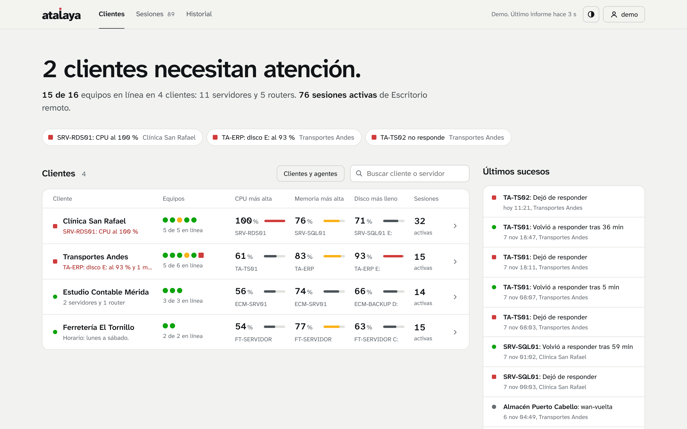
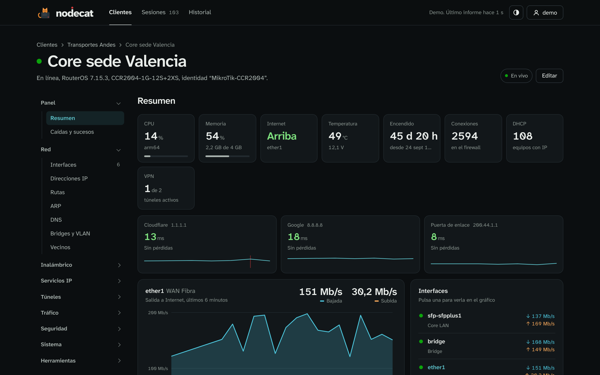
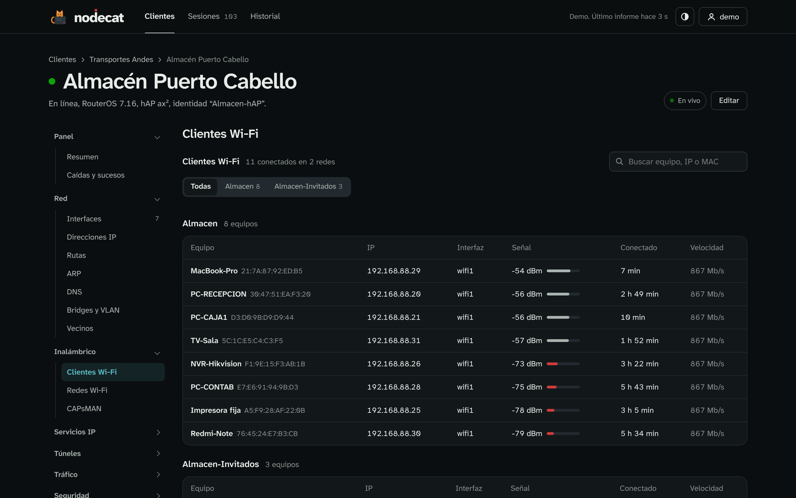
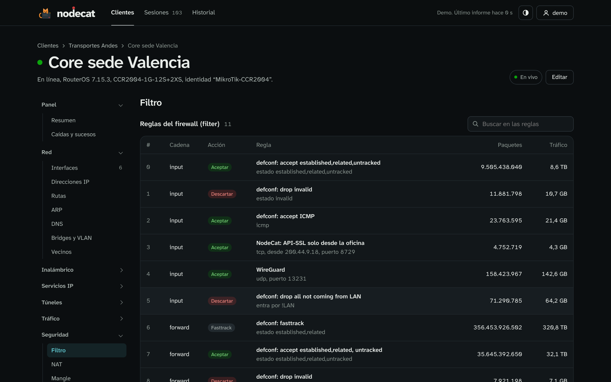
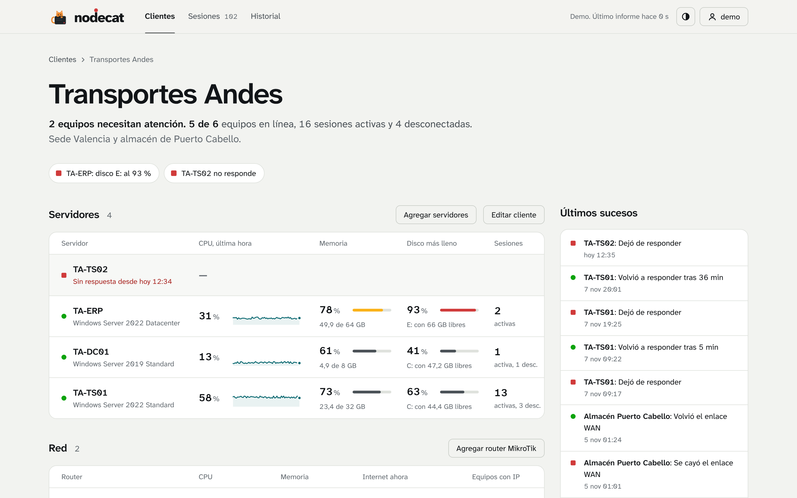
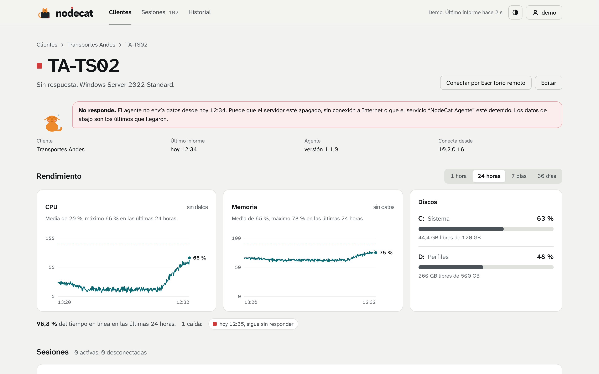
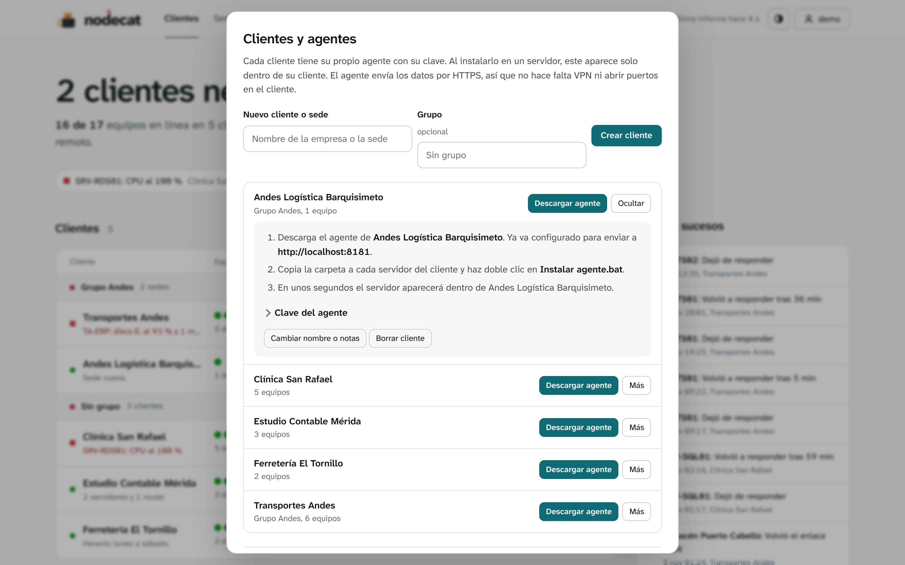
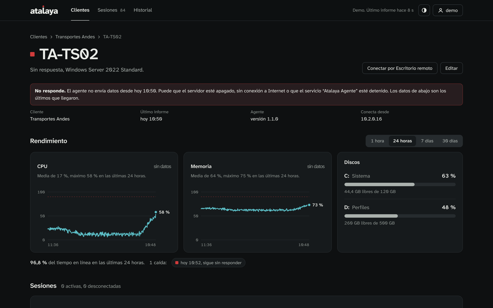

<p align="center">
  
</p>

<h1 align="center">Atalaya</h1>

<p align="center">
  Todos tus clientes, todos sus servidores, desde un mismo lugar.<br>
  Servidores Windows, routers MikroTik, sesiones de Escritorio remoto y avisos por Telegram.
</p>

<p align="center">
  
</p>

---

Atalaya es un panel web para quien da soporte a varias empresas. Cada cliente tiene su propio agente: lo instalas en sus servidores y aparecen solos dentro de su cliente, sin VPN y sin abrir puertos en su red. El agente solo necesita salida a Internet hacia Atalaya.

Es la evolución multicliente de [Vigía](https://github.com/foxyproxy14-dev/vigia), con el mismo diseño y el mismo agente.

## Qué hace

- **Resumen por cliente.** De un vistazo, qué clientes necesitan atención, cuántos servidores tienen en línea y cuál está peor de CPU, memoria o disco.
- **Página de cada cliente** con sus servidores, sus problemas y sus últimos sucesos (caídas, vueltas, reinicios).
- **Página de cada servidor** con gráficos de CPU y memoria de 1 hora a 30 días, discos, disponibilidad, caídas y sesiones.
- **Routers MikroTik al estilo MikroDash**, en solo lectura: tráfico en vivo de cada interfaz, enlace WAN, CPU, memoria, temperatura, concesiones DHCP, clientes Wi‑Fi, WireGuard y VPN, reglas del firewall con sus contadores y el registro del router. Funciona con RouterOS 6 y 7.
- **Sesiones de Escritorio remoto** en vivo de todos los clientes, e **historial** de quién entró, cuándo y desde qué equipo, exportable a Excel.
- **Avisos por Telegram** cuando un servidor o un router deja de responder, se cae el enlace WAN o se queda sin CPU, memoria o disco, y cuando se resuelve. Resumen diario por cliente. Cada cliente puede tener además su propio chat.
- **Cuentas** de administrador o de solo lectura, que se pueden limitar a algunos clientes (por ejemplo, para que un cliente vea solo lo suyo).

<p align="center"></p>

<table>
  <tr>
    <td></td>
    <td></td>
  </tr>
  <tr>
    <td></td>
    <td></td>
  </tr>
  <tr>
    <td></td>
    <td></td>
  </tr>
</table>

## El gato

Atalaya tiene mascota. Repara el servidor cuando todo va bien, corre mientras algo carga, programa cuando una lista está vacía, se impacienta si algo tarda demasiado y se avergüenza cuando hay un error. Si tu sistema tiene activado "reducir movimiento", se queda quieto.

<p align="center"></p>

## Instalar

Necesitas un servidor Linux con Docker.

```bash
git clone https://github.com/foxyproxy14-dev/atalaya.git
cd atalaya
docker compose up -d --build
docker compose logs atalaya      # aquí aparece el código de 6 cifras de la primera vez
```

Abre `http://IP-DEL-SERVIDOR:8080`, escribe el código y crea tu cuenta de administrador.

### Publicarlo en Internet

Los agentes de los clientes sin VPN necesitan llegar a Atalaya por Internet. Lo más sencillo y seguro es **Cloudflare Tunnel**: no abre puertos en tu router y pone HTTPS solo.

1. En Cloudflare Zero Trust > Networks > Tunnels, crea un túnel y copia su token.
2. Agrega un *Public hostname*, por ejemplo `atalaya.tuempresa.com`, que apunte a `http://atalaya:8080`.
3. En `docker-compose.yml`, descomenta el bloque `cloudflared`, pega el token y pon `CONFIAR_PROXY: "1"`.
4. `docker compose up -d`. En Atalaya, en *Clientes y agentes > Dirección de Atalaya para los agentes*, escribe `https://atalaya.tuempresa.com`.

Los clientes que sí tienen VPN pueden usar la IP interna (`http://10.x.x.x:8080`); el agente funciona igual.

## Agregar un cliente y sus servidores

1. Menú con tu nombre > **Clientes y agentes** > escribe el nombre > **Crear cliente**.
2. **Descargar agente**: es un ZIP ya configurado con la dirección de Atalaya y la clave de ese cliente.
3. Copia la carpeta a cada servidor del cliente y haz doble clic en **Instalar agente.bat**.

En unos segundos el servidor aparece dentro de su cliente. Para muchos servidores a la vez (GPO o script): `AtalayaAgente.exe instalar /silencioso`.

El agente funciona en Windows Server 2012 R2 o superior (y Windows 10/11) con .NET Framework 4.5 o superior. Se instala como el servicio *Atalaya Agente*, con la cuenta del sistema, y envía un informe cada 30 segundos y al momento cuando alguien entra o sale. Si se queda sin conexión guarda hasta una hora de informes y los envía al volver. Si el servidor solo sale a Internet por un proxy, añade `"proxy": "http://proxy:8080"` en su `agente.json`.

## Agregar un router MikroTik

En la página del cliente: **Agregar router MikroTik**. Atalaya se conecta a la API del router y solo lee; no puede cambiar nada.

1. En la terminal del router, crea un usuario de solo lectura y activa la API (cambia la contraseña y la IP):
   ```
   /user group add name=atalaya policy=read,api,test,!write,!policy,!sensitive,!reboot,!ftp,!ssh,!telnet,!winbox,!web,!sniff,!romon
   /user add name=atalaya group=atalaya password=UNA-CLAVE-LARGA
   /ip service set api disabled=no address=IP-DE-ATALAYA/32
   ```
2. **Si llegas al router por VPN o red interna**, usa la API normal (puerto 8728).
   **Si solo tiene IP pública**, usa API‑SSL (puerto 8729) y permite solo la IP pública de Atalaya:
   ```
   /certificate add name=api common-name=api days-valid=3650
   /certificate sign api
   /ip service set api-ssl disabled=no certificate=api address=TU-IP-PUBLICA/32
   ```
3. Escribe la IP, el usuario y la contraseña, pulsa **Probar conexión** y luego **Agregar router**.

Mientras miras la página de un router, Atalaya lo consulta cada 3 segundos; el resto del tiempo, cada 15. Guarda el tráfico de cada interfaz minuto a minuto y la contraseña cifrada en disco.

## Avisos por Telegram

Menú con tu nombre > **Notificaciones por Telegram**. Crea un bot con @BotFather, pega el token, escribe algo al bot, pulsa *Buscar chats* y elige el tuyo o el de tu grupo. Puedes decidir los umbrales (por ejemplo, CPU por encima del 90 % durante 5 minutos), recibir un resumen diario y recordar los avisos que sigan sin resolverse.

## Probarlo sin servidores reales

```bash
docker run --rm -p 8080:8080 -e ATALAYA_DEMO=1 $(docker build -q .)
```

Entra con `demo` / `atalaya-demo` (o `andes` / `atalaya-demo` para ver una cuenta limitada a un cliente). Sin Docker: `cd servidor && ATALAYA_DEMO=1 node atalaya.js` con Node.js 22.

## Copias de seguridad

Todo está en la carpeta `datos/` junto a `docker-compose.yml`: la base de datos (`atalaya.db`) y la llave que cifra el token de Telegram (`secreto.key`). Copia esa carpeta y tendrás todo.

## Ajustes del contenedor

| Variable | Para qué | Por defecto |
|---|---|---|
| `TZ` | Zona horaria del resumen diario y de los avisos | `America/Caracas` |
| `CONFIAR_PROXY` | `1` detrás de Cloudflare Tunnel o un proxy inverso | `0` |
| `PUERTO` | Puerto interno | `8080` |
| `ATALAYA_DEMO` | `1` para el modo demo | vacío |

## Cómo está hecho

- **Servidor:** Node.js 22 con SQLite integrado, sin ninguna dependencia de npm. Cliente propio de la API de RouterOS. Historial por minuto durante 7 días y cada 5 minutos durante 400 días.
- **Agente:** C# para .NET Framework 4.5, compilado con Mono (`agente/build.sh`). El ejecutable listo está en `servidor/agente/`.
- **Web:** HTML, CSS y JavaScript sin frameworks, con tema claro y oscuro y diseño adaptado al móvil.
- **Seguridad:** contraseñas con PBKDF2-SHA256, sesiones con cookie HttpOnly y protección CSRF, bloqueo tras 5 intentos fallidos, clave de agente distinta por cliente y token de Telegram cifrado en disco.

## Próximas fases

- FortiGate (solo lectura): CPU, memoria, SD-WAN y puertos.
- Sonda para leer routers de clientes sin VPN.
- Informes mensuales por cliente en PDF y Excel.
